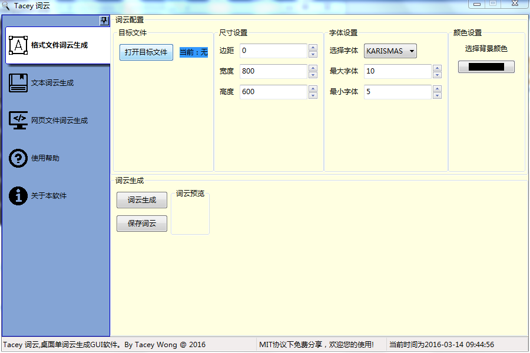

# WordCloud-Gui

词云生成工具，桌面GUI软件 - 支持跨平台运行

## 功能特性

### 核心功能
- 多数据源导入：支持 TXT、Excel、CSV 文件批量导入
- 文本清洗：自动去除停用词、标点符号、数字、特殊字符
- 中英文分词：基于 jieba 分词，支持自定义词典
- 词云生成：自定义字体、背景色、形状蒙版、颜色方案
- 词频可视化：自动生成词频 TOP20 柱状图
- 多格式导出：PNG、JPG、PDF、SVG
- 分析报告：自动生成 Markdown/HTML 格式的词云分析报告

### 新增功能
- 跨平台支持：Windows、macOS、Linux
- 现代化界面：支持亮色/暗色主题切换
- 批量处理：批量导入多个文件，批量生成词云
- 实时预览：调整参数后实时预览词云效果

## 界面截图

+ 主界面



+ 数据导入页面


+ 词频分析页面


+ 批量处理页面


## 安装说明

### 环境要求
- Python 3.7+
- 支持的操作系统：Windows / macOS / Linux

### 依赖安装

```bash
pip install -r requirements.txt
```

主要依赖：
- wxPython >= 4.1.0
- wordcloud >= 1.8.0
- pandas >= 1.3.0
- jieba >= 0.42.1
- matplotlib >= 3.4.0
- reportlab >= 3.6.0
- openpyxl >= 3.0.0
- Pillow >= 8.0.0

### 运行程序

```bash
python Main.py
```

## 使用指南

### 1. 文本处理
支持直接输入文本或导入文本文件，自动进行分词和词频统计。

### 2. 数据导入
支持导入多种格式的数据文件：
- **TXT 文件**：纯文本文件，自动分词统计
- **CSV 文件**：支持指定列进行词频分析
- **Excel 文件**：支持 .xlsx/.xls 格式，可指定工作表和列

### 3. 词频分析
- 查看词频统计结果
- 生成词频 TOP20 柱状图
- 导出词频数据

### 4. 词云生成
配置参数：
- **字体**：选择系统字体或自定义字体文件
- **尺寸**：设置词云宽度和高度
- **背景色**：自定义背景颜色
- **蒙版**：导入形状图片（如心形、圆形）
- **字体大小**：设置最大/最小字体

### 5. 批量处理
- 批量导入多个文本文件
- 自动生成词云并保存
- 支持自定义输出目录

### 6. 导出功能
- **图片导出**：PNG、JPG、PDF、SVG 格式
- **报告导出**：Markdown、HTML 格式
- 支持自定义分辨率（DPI）

## 常见问题

### 中文乱码问题
1. 确保选择支持中文的字体（如微软雅黑、宋体）
2. 在字体设置中选择系统中文字体
3. macOS/Linux 用户可能需要手动指定中文字体路径

### 字体配置
- Windows：系统会自动扫描 Windows/Fonts 目录
- macOS：扫描 /System/Library/Fonts 和 ~/Library/Fonts
- Linux：扫描 /usr/share/fonts 目录

### 跨平台兼容性
- 程序已适配 Windows、macOS、Linux
- 部分系统字体可能需要手动配置
- 建议使用 Python 3.7+ 版本

## 项目结构

```
WordCloud-Gui/
├── Main.py                 # 主程序入口
├── MyUI/                   # UI 界面模块
│   ├── MainFrame.py        # 主框架
│   ├── MyText.py           # 文本处理页面
│   ├── MyNormal.py         # 词频文件处理页面
│   ├── MyWeb.py            # HTML 文件处理页面
│   ├── MyDataImport.py     # 数据导入页面
│   ├── MyFrequency.py      # 词频分析页面
│   └── MyBatch.py          # 批量处理页面
├── Utils/                  # 工具模块
│   ├── gl.py               # 全局配置
│   ├── new_wordcloud.py    # 词云生成
│   ├── cleaner.py          # 文本清洗
│   ├── data_processor.py   # 数据处理
│   ├── visualizer.py       # 可视化
│   └── exporter.py         # 导出功能
├── data/                   # 数据文件
│   ├── stopwords/          # 停用词表
│   └── fonts/              # 字体文件
├── img/                    # 图片资源
└── requirements.txt        # 依赖列表
```

## 更新日志

### v2.0.0
- 新增多数据源导入（Excel/CSV/TXT）
- 新增文本清洗功能
- 新增中英文分词支持
- 新增词频可视化
- 新增多格式导出（PNG/JPG/PDF/SVG）
- 新增分析报告生成
- 新增跨平台支持
- 新增主题切换
- 新增批量处理功能
- 修复中文乱码问题
- 优化界面布局

## 开发说明

### 代码规范
- Python 3 兼容
- UTF-8 编码
- 模块化设计

### 扩展开发
- 新增页面：继承 wx.Panel，在 MainFrame 中注册
- 新增功能模块：放置于 Utils 目录
- 新增数据格式：扩展 data_processor.py

## 许可证

MIT License

## 贡献

欢迎提交 Issue 和 Pull Request！
